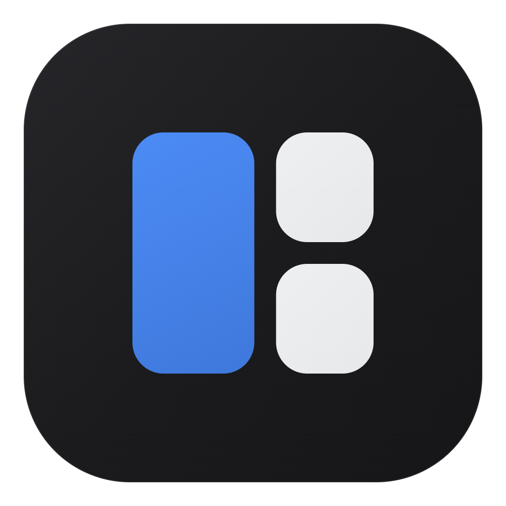

<div align="center">



# HDContainer

### One small tray app for Windows that does four everyday jobs: groups a task's windows into one app, turns your voice into text, converts files from the right‑click menu, and downloads torrents.

[](https://github.com/helldogsify/HDContainer/releases/latest)
[](https://github.com/helldogsify/HDContainer/releases/latest)
[](LICENSE)

</div>

---

## What's inside

| | |
|---|---|
| **[Window containers](#window-containers)** | A set of windows becomes one program: one taskbar button, one Alt+Tab entry. Switch your whole workspace with a single keystroke. |
| **[Voice input](#voice-input)** | Hold **Left Alt** and talk. The text appears where your cursor is, cleaned up by an LLM. Select text first and your words become an instruction for it. |
| **[Convert to](#convert-files-from-the-right-click-menu)** | Right‑click any image, audio, video, document or table in Explorer → **Convert to** → pick a format. |
| **[Torrents](#torrents)** | Open a `.torrent` file and it starts downloading. Progress, pause and delete are in the tray menu. |

Everything lives in the **system tray** — there is no main window. Click the tray icon for the menu; **Settings** has a tab for each tool. Installs per‑user, **no admin rights**, updates itself.

## Window containers

### The problem

You almost never work in a single app. A task is a **set of windows open together** — an editor, a browser to check your changes, a terminal, maybe a show playing on the side. That's your rig for *that* task.

Then you switch to something else — writing a document that you want full‑screen. When you come back to coding, you're mashing **Alt+Tab** to dig out each window and dragging them back into place. Every single time. And after a reboot you rebuild the whole layout from scratch.

### What a container does

It makes a set of windows behave like **one program**. You drop everything a task needs into one **container** — from then on it's a single taskbar button and a single Alt+Tab entry.

So switching tasks becomes **one keystroke**: Alt+Tab and your entire working set flips at once — coding rig out, writing rig in, right where you left it. No window hunting, no re‑arranging.

> Coding → **Alt+Tab** → your research paper. One press, the whole set of tools in front of you changed.

And it's **not** a hack that jams windows inside another and breaks your typing. Every window stays a normal window, so the keyboard, clipboard and the **Alt+Shift** layout switch all keep working — HDContainer only *groups* them.

### How you use it

- **Make a container** (tray → **Create container**), give it a name, and pick its windows from an Alt+Tab‑style preview grid.
- **Run several containers at once** — each is its own taskbar button with a real live preview. Alt+Tab between them like between apps.
- **Minimize and restore the whole set** from its taskbar button or with Win+D. Windows come back exactly as they were — full‑screen ones full‑screen, the rest at their size and position.
- **Minimize one window** inside a container and it steps out on its own; restore it and it snaps back into the group. Minimizing the last visible window minimizes the container.
- **Color‑label** a container so you can tell your "work" rig from your "research" rig at a glance.
- **Give it an icon** — drop in any image (PNG, JPG, WebP…) like setting an avatar; it's cropped to a square (transparency kept) and becomes the container's taskbar and shortcut icon.
- **Save it as a desktop shortcut** — one click reopens the container. Windows that are still open snap back exactly where they were; apps that were closed get relaunched (their exact size/position can't always be reproduced). Your workspace survives reboots.
- **Tick a container in the tray menu** to switch it on or off — no digging into submenus.

<div align="center">

<br><sub>Color-label each container to tell your workspaces apart</sub>
</div>

## Voice input

Hold **Left Alt** anywhere and talk (any key or combination can be set instead). A small animated indicator appears above the clock while HDContainer listens; let go and your speech is turned into text.

- **Nothing selected**: dictation. Speech is recognized, then cleaned up by an LLM (punctuation, misheard words, filler words) and typed into the text field under your cursor. If the cursor isn't in a text field, the text goes to the clipboard.
- **Text selected**: what you say is an instruction for that text, like *"translate into English"*, *"tidy this up"* or *"check for mistakes"*. The result replaces the selection, or goes to the clipboard if the text can't be edited. If you ask a question about the text (*"what does this mean?"*), the answer goes to the clipboard and your text is left untouched.
- **Commands while dictating.** Start or end your dictation with an instruction, like *"…see you at ten. Translate to English"*, *"make it more formal"* or *"as a list"*. It is applied to the text and left out of the result. Commands are looked for mainly at the beginning and the end. A phrase addressed to someone else (*"Masha, translate this contract into English"*) stays part of your message.
- **Dictation history.** Every result is kept on your PC (the last 200), so a text pasted into the wrong place or overwritten in the clipboard isn't lost: tray → **Dictation history** to search, copy it again or delete. Can be turned off.

Everything is set up in **Settings → Voice input**:

| | Options |
|---|---|
| Speech recognition | **Local Whisper** ([whisper.cpp](https://github.com/ggml-org/whisper.cpp)): offline, free and private. The model (base / small / large‑v3‑turbo) is downloaded on first use and kept in memory while you use it. Or any **OpenAI‑compatible** transcription API (Groq, OpenAI, your own server). |
| Text processing | **Claude Code**: uses your Claude subscription through the `claude` CLI, with no API key. **Anthropic API key.** **Any OpenAI‑compatible API**: OpenAI, OpenRouter, Gemini, Groq, DeepSeek, Mistral, xAI, or local Ollama / LM Studio. |
| Hotkey | Left Alt by default, or any key or combination; *hold to talk* or *press to start / press to stop*. Left Alt pressed together with another key (Alt+Tab, Alt+Shift…) works as usual. Esc cancels. |
| Behavior | Paste automatically or just copy; keep your original clipboard; editable LLM instructions; a vocabulary hint for names and terms. |

API keys are stored encrypted with Windows DPAPI under your user account.

**One Claude Code for all your PCs.** On the computer that has Claude Code, turn on *Voice input → Share Claude Code with other computers*. On your other computers, choose *Claude on another computer* and paste the address and key it shows. Those computers then need neither Claude Code nor an API key. The shared endpoint is OpenAI‑compatible, accepts only private networks (Tailscale, LAN) and requires the key. It keeps a Claude process warmed up, and the other PC asks it to warm up as soon as you start talking.

## Convert files from the right-click menu

Right-click any image, audio, video, document or data file in Explorer (or a whole selection of them) → **Convert to** → pick a format. The result lands next to the original with the same name and the new extension (`report.docx` → `report.md`; if the name is taken you get `report (2).md`). A selection is converted one file after another in a single progress window.

| Files | Converts to | Engine |
|---|---|---|
| png, jpg, webp, heic/heif, avif, bmp, gif, tiff, ico | png, jpg, webp, heic, avif, bmp, gif, ico, tiff, pdf | Pillow + libheif (built in) |
| svg | png, jpg, pdf | Edge/Chrome, headless |
| mp3, wav, ogg, flac, m4a, aac, wma, opus, aiff, amr | mp3, wav, ogg, flac, m4a, aac, opus | [FFmpeg](https://github.com/BtbN/FFmpeg-Builds) |
| mp4, mkv, mov, avi, webm, wmv, m4v, ts, flv, mpg, 3gp, mts, vob | mp4, mkv, webm, mov, avi, gif + mp3/wav/m4a (audio track) | FFmpeg |
| srt, vtt, ass, ssa | srt, vtt, ass | FFmpeg |
| md, docx, html, txt, rtf, odt, epub, fb2, tex, rst, org | **pdf**, docx, md, html, txt, rtf, odt, epub, fb2, tex, rst | [Pandoc](https://github.com/jgm/pandoc) (+ Edge for pdf) |
| pdf | png, jpg (one image per page), txt, html, docx, md, epub, odt, rtf | [Poppler](https://github.com/oschwartz10612/poppler-windows) (+ Pandoc) |
| csv, tsv, json, xlsx (first sheet) | csv, tsv, json, xlsx, html, pdf | built in |

FFmpeg (~190 MB), Pandoc (~40 MB) and Poppler (~45 MB) are downloaded from their GitHub releases the first time they're needed — or in advance from **Settings → Converter** — and verified against the SHA‑256 digest GitHub publishes. PDF output uses the Microsoft Edge (or Chrome) already on the PC in headless mode. On Windows 11 the item is under **Show more options** (or Shift + right‑click). The menu is a few per‑user registry keys — no admin rights; turn it off in **Settings → Converter**, and it is removed on uninstall.

## Torrents

Open a `.torrent` file with HDContainer and it starts downloading right away — no windows, no questions. Each download shows up in the tray menu with its progress, speed and time left, plus two buttons: pause/resume and delete (it asks first, and removes the partly downloaded files). Click a name to open its folder. When a download finishes, the indicator above the clock shows its name — click it to open the folder.

**Settings → Torrents** holds the save folder (your Downloads by default) and the presets, all on by default: maximum speed with no limits, forced seed requests while seeds are scarce, merging seeds from every tracker, the DHT and a second copy of the same torrent, leaving the swarm as soon as the download finishes, and removing finished downloads from the list. Unfinished downloads continue after a restart. Built on [libtorrent](https://libtorrent.org/).

The installer makes HDContainer the handler for `.torrent` files. If another torrent client keeps opening them, right‑click a `.torrent` → **Open with** → **HDContainer** → **Always**. The first download makes Windows ask whether HDContainer may use the network — allow it, or the speed drops.

## Install

1. Download **[HDContainer-Setup.exe](https://github.com/helldogsify/HDContainer/releases/latest)**.
2. Run it — installs per‑user, **no admin rights**.
3. Launch **HDContainer**; it sits in the system tray. Click its icon to open the menu.

It quietly checks GitHub for new versions and can update itself (**Settings → General**); the downloaded installer is checked against the SHA‑256 digest GitHub publishes for the release before it runs. Prefer no installer? Grab the portable **HDContainer.exe** from the same release — a portable copy only tells you about new versions and opens the release page, it doesn't install anything on its own, and `.torrent` files aren't associated with it.

The executables aren't code‑signed yet, so on first run Windows SmartScreen may show "Windows protected your PC" — choose **More info → Run anyway**.

Available in English, Русский, Español, Português, Deutsch, Français and 中文 (auto‑detected, switchable in Settings).

## How it works under the hood

Each active container is an invisible **owner window** — a real, minimizable window kept fully transparent via a layered surface (so Win+D and the taskbar button genuinely minimize the whole group). Member windows are made *owned* by it via `SetWindowLongPtr(GWLP_HWNDPARENT)` — they are **not** reparented. Ownership alone gives you: members float above the (invisible) host, hide and show with it (group minimize, Win+D), and collapse into one taskbar/Alt+Tab entry — all **without merging input queues**, which is exactly why native typing and the global Alt+Shift layout switch keep working. A unique per‑window AppUserModelID keeps each container as its own taskbar button.

The app is Python — `tkinter` for the UI and `ctypes` for the Win32 work — packed into one exe with PyInstaller:

| Part | Files | Built on |
|---|---|---|
| Tray, containers, settings, updater | `window_container.py` | stdlib + [Pillow](https://python-pillow.org/) for icons |
| Voice input | `voice.py`, `voice_engines.py`, `voice_sys.py` | microphone through `winmm`, selection and text fields through UI Automation, pasting with `SendInput`; whisper.cpp server downloaded on first use; LLM connectors are plain HTTP or a `claude` subprocess |
| Converter | `convert.py` | Pillow + pillow‑heif; FFmpeg, Pandoc and Poppler downloaded on demand; Edge/Chrome for PDF |
| Torrents | `torrents.py` | [libtorrent](https://libtorrent.org/) |

## Build from source

Needs Windows, [Python 3.10+](https://www.python.org/) (releases are built with 3.12), and [Inno Setup 6](https://jrsoftware.org/isdl.php) for the installer.

```powershell
pip install pyinstaller pillow pillow-heif libtorrent
powershell -ExecutionPolicy Bypass -File build.ps1   # dist\HDContainer.exe + dist\HDContainer-Setup.exe
```

The build stops if the torrent module doesn't import, and the release workflow checks voice input and the converter the same way, so a missing package can't silently drop a feature from the exe.

Releases are built by GitHub Actions: a push to `main` with a new version number in `installer.iss` and `window_container.py` builds both files on a Windows runner and publishes release `v<version>` with `release-notes.md` as its description.

## Support

Vibe‑coded by **hdk** with [Claude Code](https://claude.com/claude-code). Free for everyone.

If it saved you some window‑juggling, you can tip the author:

**USDT · TRON (TRC20)**
```
TWG8Y5EyaqQf8GsJKJVhcaAMFZxxHoPWzC
```

## License

[MIT](LICENSE) © hdk
